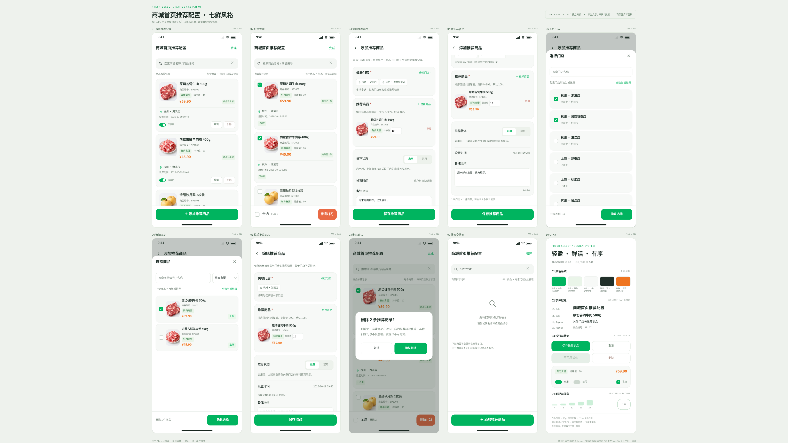

# 商城首页推荐商品配置 · 七鲜风格

本版对应已确认的「商城首页推荐商品配置」交互原型。以七鲜 App 的鲜绿、白底、轻量商品卡片作为视觉参考，画板统一为 **390 × 844**，采用思源黑体、16px 圆角、细分割线、独立商品照片和线性图标。

## 设计文件

- **[下载可编辑 Sketch 文件](商城首页推荐配置-七鲜风格.sketch)**
- [查看 4K 总览](设计稿总览-4K.png)
- [浏览逐页 PNG](预览/)
- [查看云端验证记录](验证结果.json)
- [Sketch 本机原生导出与检查脚本](Sketch原生导出与检查.js)

## 页面

| 画板 | 内容 |
| --- | --- |
| 01 首页推荐记录 | 商品名/编号搜索、每商品每门店独立卡片、编辑/删除、启用状态、底部添加 |
| 02 批量管理 | 商品记录勾选、全选、批量删除 |
| 03 添加推荐商品 | 多选门店、多选商品、逐件填写排序值 |
| 04 状态与备注 | 启用/禁用、设置时间、底部备注；添加页滚动后的视图 |
| 05 选择门店 | 门店搜索、多选、已选数量与确认 |
| 06 选择商品 | 分类筛选、编号/名称搜索、主图、编号、名称、分类、价格与上架状态 |
| 07 编辑推荐商品 | 独立编辑当前商品与门店关系 |
| 08 删除确认 | 批量删除前的二次确认 |
| 09 搜索空状态 | 无匹配商品时保留搜索与添加入口 |
| 10 UI Kit | 颜色、字体、按钮、开关、标签、选择状态、圆角与间距规范 |

## 已落实的需求

- 每个「商品 × 门店」一张独立卡片，显示商品信息和关联门店。
- 商品名称加粗，编号添加“商品编号：”前缀，分类标签与排序值同一行。
- 显示设置时间，提供启用/禁用、编辑和单条删除。
- 首页右上角“管理”，底部固定大按钮“添加推荐商品”。
- 移除配置名称、创建人、汇总数量及商城效果预览入口。
- 配置名称改为内部备注，放在表单底部；不设置生效时间。

## 原生可编辑结构

一个 `.sketch` 文档包含 10 个独立画板。文字、背景、卡片、按钮、开关、复选框与线性图标都使用原生 Text / Rectangle / Oval / ShapePath / Group 图层，按模块命名并保持解锁。配置共享文字、图形和颜色样式。商品照片为小尺寸可替换 Bitmap；没有整页位图或整页 SVG 图层。滚动区域及商品圆角通过原生蒙版实现。

同一商品在不同门店的推荐记录独立管理。多商品、多门店组合形成独立记录；排序值 0–999，默认 100。启用/禁用及删除仅影响当前关系。设置时间记录最近保存/状态切换，备注仅供内部使用。正式权限仍需业务确认。

## 验证范围

已校验 Sketch 官方 JSON Schema、归档、10 个画板尺寸、文字与图层类型、商品图片引用和蒙版结构，并从生成的 `.sketch` 重新读取实际图层生成预览、复核布局。逐页 PNG 为 1170 × 2532（3 倍），总览为 3840 × 2160。图片是演示商品素材，不是七鲜官方素材。

当前运行环境为 Linux 云环境，**尚未在 Mac Sketch 中实际打开或渲染验证**。PNG 是从文档图层重建后由 Chromium 渲染的检查图，不是 Sketch 原生导出。Sketch 为静态多画板设计文件；搜索、勾选等业务状态通过不同画板表达，不包含实际业务后端。

Mac 上安装 [思源黑体 CN Regular / Bold](https://github.com/adobe-fonts/source-han-sans) 后打开文件，可直接修改文字、颜色、大小、位置和商品图片。附带 JS 可在 Sketch 的“插件 → 运行脚本”中执行，选择本文件后，在桌面生成单独的 Sketch 副本、由 Sketch 原生导出的 PNG 和本机检查结果。该脚本已通过语法检查，尚未在 Mac 执行。
